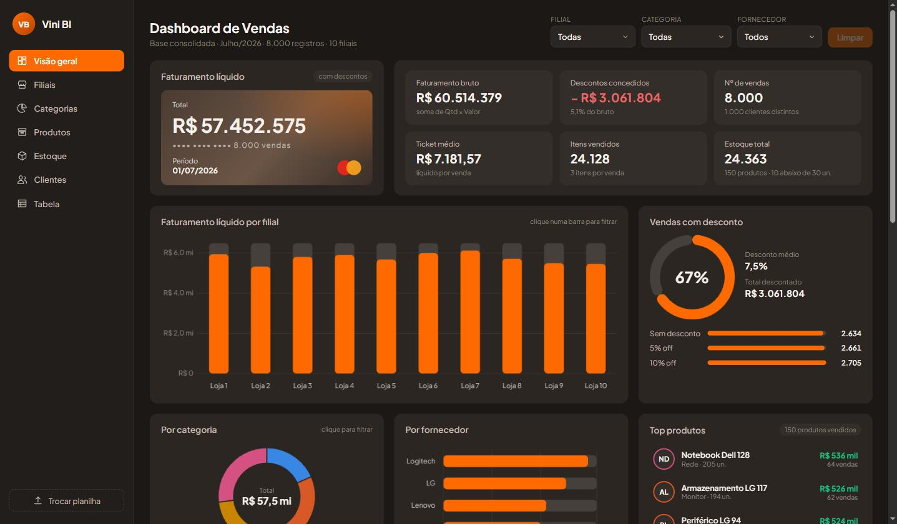

# Dashboard de Vendas

Dashboard web interativo que lê uma planilha Excel direto no navegador e mostra os indicadores de vendas com gráficos animados. Projeto de estudo em **Análise de Dados / BI** com dados fictícios.



## Indicadores

- **KPIs:** faturamento líquido e bruto, descontos concedidos, nº de vendas, ticket médio, itens vendidos e estoque total
- **Faturamento por filial** (barras)
- **Vendas com desconto** (gauge + faixas de 0%, 5% e 10%)
- **Faturamento por categoria** (rosca) e **por fornecedor** (barras horizontais)
- **Curva ABC de produtos** (linha do faturamento acumulado, com classes A/B/C)
- **Top produtos**, **top clientes** e **estoque crítico**
- **Resumo por filial** em tabela ordenável

### Interatividade

- Filtros por filial, categoria e fornecedor; todos os gráficos se atualizam com animação
- Clicar numa barra de filial, numa fatia da rosca ou numa linha da tabela aplica o filtro
- Botão **Trocar planilha** carrega outro arquivo `.xlsx` com a mesma estrutura
- Layout responsivo (desktop, tablet e celular)

## Tecnologias

- HTML, CSS e JavaScript puro (sem framework e sem etapa de build)
- [SheetJS](https://sheetjs.com/) para ler o `.xlsx` no navegador
- [Chart.js](https://www.chartjs.org/) para os gráficos

## Estrutura

```
├── index.html            # estrutura da página
├── css/style.css         # tema escuro + destaque laranja, responsivo
├── js/
│   ├── utils.js          # formatação (R$, %, números) e helpers
│   ├── data.js           # leitura da planilha e cálculo dos indicadores
│   ├── charts.js         # criação/atualização dos gráficos
│   ├── ui.js             # KPIs, listas, tabela, filtros e navegação
│   └── app.js            # orquestração e estado dos filtros
├── data/Base_Consolidada.xlsx
└── iniciar_dashboard.bat # atalho para rodar localmente no Windows
```

## Como rodar

O navegador não deixa uma página aberta direto do disco (`file://`) ler arquivos, então é preciso um servidor local:

- **Windows:** dê dois cliques em `iniciar_dashboard.bat`
- **Qualquer sistema:** `python -m http.server 8765` na pasta do projeto e acesse `http://localhost:8765`

Se abrir o `index.html` direto, a página pede para você selecionar ou arrastar a planilha.

**GitHub Pages:** em *Settings → Pages*, publique a branch `main` (pasta raiz). A planilha em `data/` é carregada automaticamente.

## Dados

A planilha `Base_Consolidada.xlsx` tem 8.000 vendas fictícias (10 filiais em SP, 150 produtos, 1.000 clientes), consolidadas a partir das abas *Vendas, Clientes, Filiais, Produtos, Categorias, Estoque* e *Vendedores*. O dashboard usa as abas `Base-Consolidada`, `Estoque` e `Produtos`.
